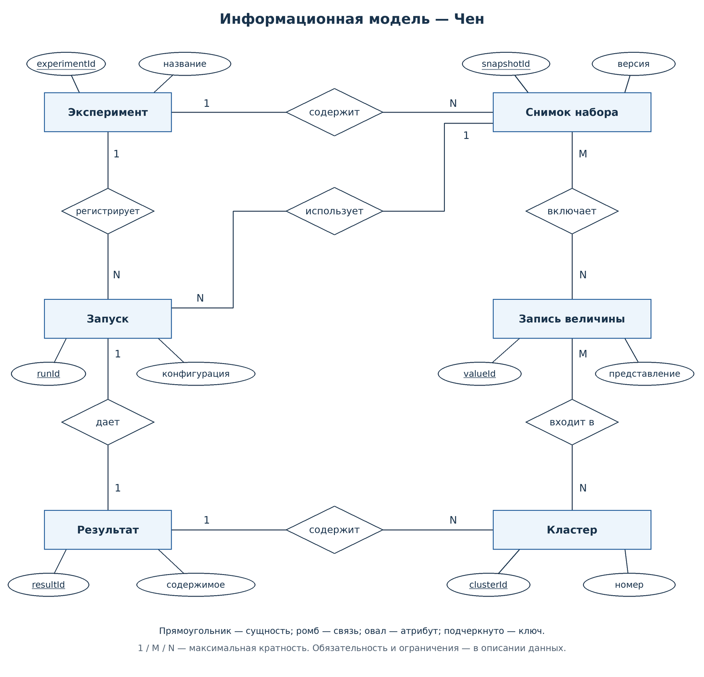
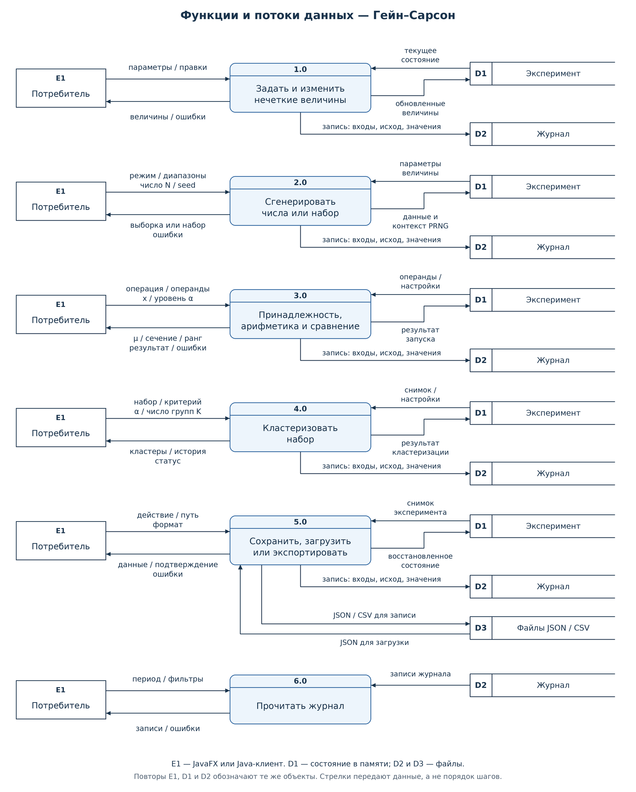
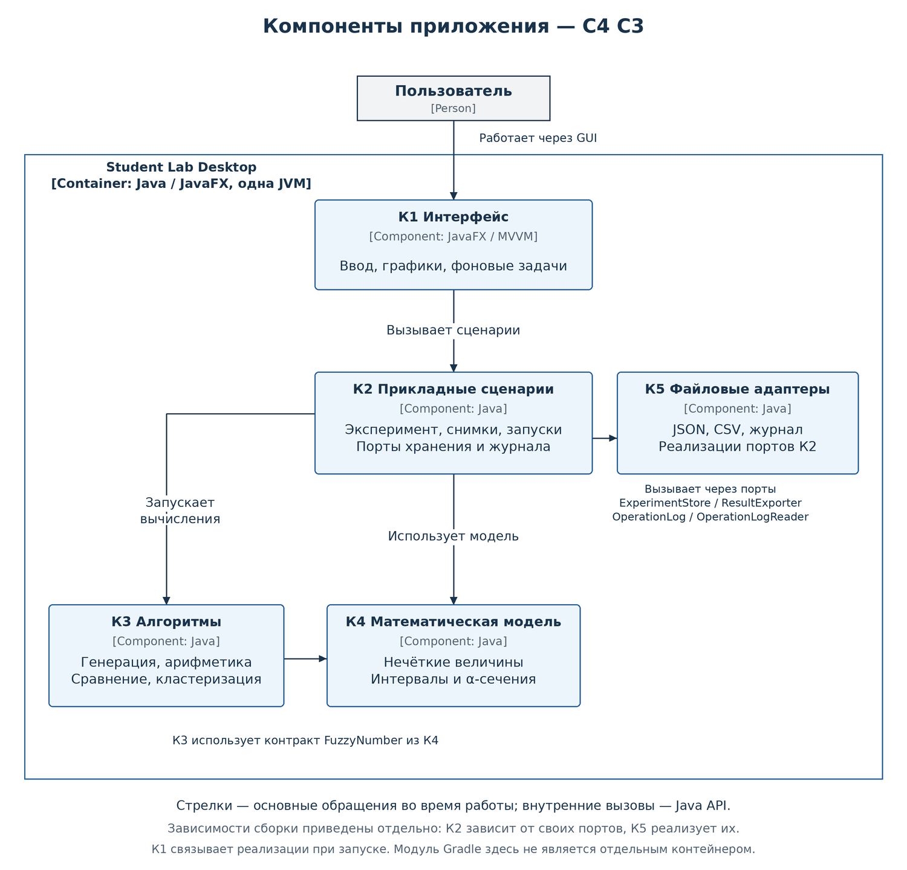

# Архитектура Student Lab

Student Lab работает локально в одном процессе JVM. JavaFX-интерфейс использует
прикладные сценарии; внешняя Java-программа может подключить вычислительные
библиотеки без GUI и файловых адаптеров.

## Модули и зависимости

| Модуль | Ответственность | Допустимые зависимости |
|---|---|---|
| `fuzzy-core` | `FuzzyNumber`, параметры, интервалы, α-сечения и инварианты | Стандартная Java |
| `fuzzy-algorithms` | Арифметика, ранжирование, расстояние, генераторы, кластеризация | core |
| `fuzzy-application` | Эксперименты, снимки, запуски, сценарии и порты | core, algorithms |
| `fuzzy-io` | JSON, CSV, JSON Lines журнал и реализации портов | core, application |
| `fuzzy-desktop` | JavaFX, MVVM, фоновые задачи и композиция приложения | application, core; io и algorithms только в bootstrap |

Циклы и обратные зависимости запрещены. Обработчик кнопки вызывает сценарий,
а файловый адаптер сериализует данные и не выполняет алгоритмы. Обращение сценария
к адаптеру идёт через порт application и не создаёт зависимость `application → io`.
Реализации передаются через конструкторы при запуске приложения.

## Контракты

| Контракт | Модуль | Назначение |
|---|---|---|
| `FuzzyNumber` | core | Принадлежность, α-сечение и замкнутый носитель |
| `FuzzyDistance` | algorithms | Критерий близости для кластеризации |
| `FuzzyRanking` | algorithms | Числовой ранг для сравнения |
| `ExperimentStore` | application | Сохранение и загрузка эксперимента |
| `OperationLog` | application | Запись структурированного журнала |
| `OperationLogReader` | application | Чтение и фильтрация журнала |
| `ResultExporter` | application | Экспорт результата |

Аналитическая ограниченная величина Стьюдента и табличный результат реализуют
один контракт `FuzzyNumber`: конечные вложенные интервалы на [0,1], корректный
носитель и принадлежность в [0,1]. Их формулы описаны в [математической модели](math-model.md).

Параметры и интервалы неизменяемы и проверяются при создании. Сущности имеют
идентичность. Критерии выделены по Strategy, файлы подключены через Adapter,
зависимости внедряются через конструкторы, GUI разделён по MVVM.

## Данные и связи

- **Эксперимент** содержит название, настройки, снимки и историю запусков.
- **Снимок набора** хранит неизменяемое состояние выбранного набора.
- **Запись величины** связывает идентификатор с неизменяемым математическим представлением.
- **Запуск** фиксирует действие, конфигурацию, упорядоченные ссылки на операнды и исход.
- **Результат** содержит успешный ответ: величину, число, набор или разбиение.
- **Кластер** содержит записи величин из входного снимка конкретного результата кластеризации.

Эксперимент имеет произвольное число снимков и запусков; каждый из них принадлежит
одному эксперименту. Запись величины может входить в несколько снимков. Редактирование
создаёт новую запись и новый снимок, сохраняя прежние входы результатов.

Запуск арифметики или кластеризации связан с одним входным снимком. Одна запись
может занимать обе позиции бинарной операции. Успешный запуск имеет ровно один
результат, ошибочный или отменённый — ни одного. В разбиении каждая запись входа
входит ровно в один из K непустых кластеров.

Запуски и результаты относятся к действиям 1.0–4.0. Файловые команды и чтение журнала
возвращают DTO-ответы. Добавление вычисленной величины в набор — отдельное действие,
создающее запись и снимок. ER-модель описывает предметные данные, а не схему Java-классов.

## Функции и потоки

Граница DFD — вычислительная и прикладная часть. E1 — GUI или внешний Java-клиент.
D1 — эксперимент в памяти, D2 — журнал, D3 — файлы JSON/CSV. Повторы обозначений
относятся к тем же объектам. Стрелки передают данные, а не порядок выполнения.

Функции: 1.0 — задать величины; 2.0 — генерация; 3.0 — принадлежность, арифметика
и сравнение; 4.0 — кластеризация; 5.0 — сохранение, загрузка и экспорт; 6.0 — журнал.
Каждой функции соответствует отдельная BPMN в [описании процессов](processes.md).

## Компоненты и выполнение

Один контейнер C4 соответствует приложению в одной JVM. Компоненты выделены по
ответственности и сопоставлены с модулями Gradle. Стрелки C4 показывают обращения
во время работы; направление зависимости сборки определяется контрактами и портами.

Сценарий проверяет запрос и фиксирует входной снимок, вызывает алгоритм, проверяет
результат и последовательно публикует изменения. Затем записывает значения в журнал
и возвращает ответ интерфейсу. Исходы параметров, вычислений, отмены и файловых ошибок
различаются; NaN не используется как успешный ответ.

Ядро и алгоритмы синхронные. Desktop организует фоновые задачи, прогресс и отмену.
Задача захватывает experimentId, snapshotId и настройки. Поздний ответ сохраняет
связь со своими входами и не подменяет другой активный эксперимент.
Отмена принимается до публикации; частичный результат не публикуется.

JSON загружается через полностью проверенный кандидат состояния. Сохранение и экспорт
используют временный файл и атомарную замену. Журнал JSON Lines хранит фактические
значения; сбой его записи возвращается отдельным предупреждением. Чтение журнала
не журналирует само себя. Подробности — в [процессах](processes.md).

## Расширение

Новый вид величины реализует `FuzzyNumber` с теми же инвариантами; новый критерий —
`FuzzyDistance` или `FuzzyRanking`; новый формат — адаптер соответствующего порта.
Другой интерфейс может использовать те же сценарии application.

Неконвексные множества с несколькими интервалами в одном сечении потребуют другого
контракта. Формат JSON и публичный API версионируются отдельно. Значения по умолчанию
задаются конфигурацией и не зашиваются в алгоритмы.
