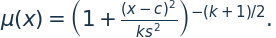
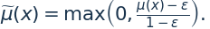
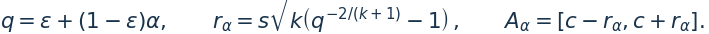
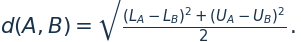
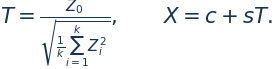

# Математические решения, влияющие на архитектуру

## Исходная нечёткая величина

Начальная функция принадлежности — плотность Стьюдента, делённая на её максимум, со сдвигом и масштабом:

<!-- formula: student-membership
\mu(x)=\left(1+\frac{(x-c)^2}{ks^2}\right)^{-(k+1)/2}.
-->

`c` — центр, `s>0` — масштаб, `k>0` — число степеней свободы (в проекте целое). `s` не называется стандартным отклонением. Это функция принадлежности, а не плотность вероятности.

Для конечного носителя вводится общая настройка 0 < ε < 1:

<!-- formula: bounded-membership
\widetilde{\mu}(x)=\max\left(0,\frac{\mu(x)-\varepsilon}{1-\varepsilon}\right).
-->

Так сохраняются непрерывность и максимум 1. Изменение исходной функции принадлежности не превышает ε; это не оценка ошибки всей цепочки арифметических операций. Значения по умолчанию: `k=5`, `ε=0.001`.

## Сечения и представление результата

Для 0 < α ≤ 1:

<!-- formula: alpha-cut
q=\varepsilon+(1-\varepsilon)\alpha,\qquad
r_\alpha=s\sqrt{k\left(q^{-2/(k+1)}-1\right)},\qquad
A_\alpha=[c-r_\alpha,c+r_\alpha].
-->

При α=0 эта же формула задаёт замыкание положительного носителя. Нулевое сечение определяем именно так, а не условием μ≥0. При α=1 получается центр. Для k=5 и ε=0.001 радиус носителя приблизительно равен 6.7082s.

Исходный объект вычисляет сечения аналитически. Результат арифметики хранится как таблица на общей сетке `0, 0.01, …, 1`; между уровнями границы интерполируются линейно. Табличная модель также предоставляет принадлежность: внутри носителя это supremum уровней, сечения которых содержат x; вне носителя — 0. Вложенность интервалов обязательна.

Обе модели реализуют `FuzzyNumber`; результат не обязан сохранять форму Стьюдента. Сетка является численным приближением. Сохранённые узлы обязательно включают 0 и 1, уровни строго возрастают, границы конечны, левая граница не убывает, правая не возрастает и левая не больше правой. Разные входные сетки оцениваются на общей сетке операции; она сохраняется с результатом. Точность табличного представления зависит от сетки; универсальная граница ошибки не задана. Непредставимые в `double` результаты дают численную ошибку, а не успешный объект с бесконечностями.

## Арифметика и сравнение

Пусть на одном уровне α заданы A=[a,b] и B=[u,v].

| Операция | Результат сечения |
|---|---|
| A+B | [a+u, b+v] |
| A−B | [a−v, b−u] |
| A×B | min и max четырёх произведений au, av, bu, bv |
| A÷B | min и max четырёх отношений a/u, a/v, b/u, b/v |

Деление разрешено только если замкнутый носитель B не содержит 0. Проверяется вся операция заранее по условию `L₀ ≤ 0 ≤ U₀`. Допуск сравнения чисел не используется, чтобы искусственно убрать ноль из носителя; уровни с нулём не отбрасываются. Формулы используют декартово произведение сечений; зависимость повторяющихся операндов не отслеживается. Поэтому обычный вызов вычитания A−A может дать интервал, а не точный ноль.

Базовое сравнение: среднее середин сечений на общей заданной сетке. Все сравниваемые объекты оцениваются на этой сетке, включая результаты с иной внутренней сеткой. Ранжирование по конечному числовому рангу использует обычный числовой порядок; произвольный допуск не вводится в Java Comparator, чтобы не нарушить транзитивность. Формат округления в GUI не меняет порядок. Для исходных симметричных величин ранг равен c. Одинаковый ранг означает только равенство по этому критерию, а не совпадение функций; этот результат нужно прямо обозначать в GUI.

## Генерация и кластеризация

Генератор набора выбирает случайные `c` и `s` в заданных допустимых диапазонах; базово — равномерно. `k` и `ε` общие. Один объект — целая нечёткая величина, а не случайная точка графика. Сохраняются диапазоны, N, seed, параметры и версия алгоритма генерации. Для задания GUI предлагает N от 100 до 300; вычислительные операции библиотеки не ограничены этим диапазоном.

Для кластеризации задаются один общий уровень 0 < α < 1 и целевое число групп 1 ≤ K ≤ N. Признаки — границы сечения. Расстояние:

<!-- formula: alpha-cut-distance
d(A,B)=\sqrt{\frac{(L_A-L_B)^2+(U_A-U_B)^2}{2}}.
-->

При общих k и ε оно учитывает центр и масштаб. Для произвольных форм разные функции могут иметь одинаковое сечение: критерий сравнивает именно выбранный уровень, а не всю функцию. На общем классе нечётких величин это псевдометрика: нулевое расстояние возможно у разных функций. Для выбранного семейства с общими k и ε и 0<α<1 границы определяют c и s однозначно. Уровень α=1 исключён из базового сценария, поскольку у исходных величин он теряет информацию о ширине.

Агломеративный алгоритм начинает с одиночных групп, объединяет ближайшие по среднему попарному расстоянию и заканчивает при K группах. При равных расстояниях пара выбирается по стабильным идентификаторам входного снимка. Кластеризация выдаёт чёткое разбиение нечётких объектов: объект принадлежит одной группе. Нечёткая принадлежность к кластерам — другая постановка, здесь не используется.

Отдельный дополнительный генератор обычных чисел Стьюдента использует независимые стандартные нормальные Z:

<!-- formula: student-sampling
T=\frac{Z_0}{\sqrt{\frac{1}{k}\sum_{i=1}^{k}Z_i^2}},\qquad X=c+sT.
-->

Он возвращает числовую выборку и не применяет ε-преобразование. Этот режим не подменяет генератор нечётких объектов для задания.

## Численные и прикладные границы

Все параметры и результаты должны быть конечными. Даже допустимые по знаку параметры могут привести к переполнению: проверяется вычислимость носителя, сечений и результатов. Бесконечность, NaN и сломанная вложенность дают численную ошибку. Небольшой положительный знаменатель не объявляется нулём произвольно, но непредставимый результат деления отклоняется.

Для расчёта радиуса полезна устойчивая форма `s * sqrt(k * expm1(-2*log(q)/(k+1)))`; проверка конечности остаётся обязательной. Генератор обычных чисел не принимает нулевой знаменатель из-за вырожденной машинной реализации нормальной выборки: он повторяет набор нормальных значений с ограничением числа попыток и затем сообщает ошибку. Воспроизводимость определяется seed, алгоритмом PRNG и версией генератора.

Агломеративная кластеризация со средней связью допускает простой алгоритм для N≤300: одна матрица расстояний, начальные одиночные группы, обновление средних расстояний после объединения. Можно использовать O(N²) памяти и O(N³) времени при линейном поиске лучшей пары на каждом шаге. Алгоритм рассчитан на наборы до 300 объектов. При K=N объединений нет. История содержит N−K объединений; все записи входа входят ровно в одну непустую группу.

Ни α принадлежности, ни ε ограничения хвостов не являются уровнем статистической значимости. Деление на носитель, содержащий ноль, не допускается.
