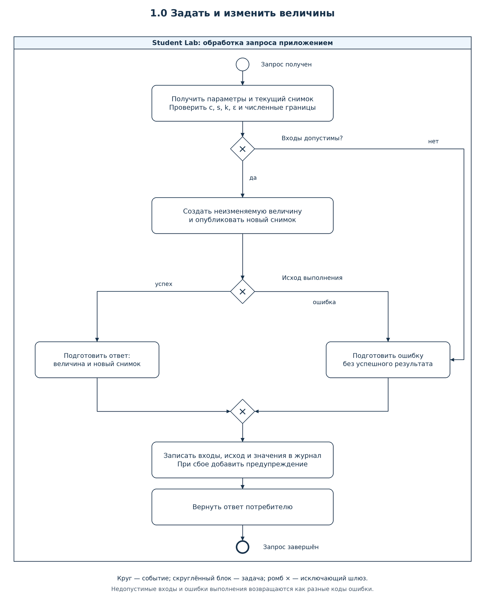
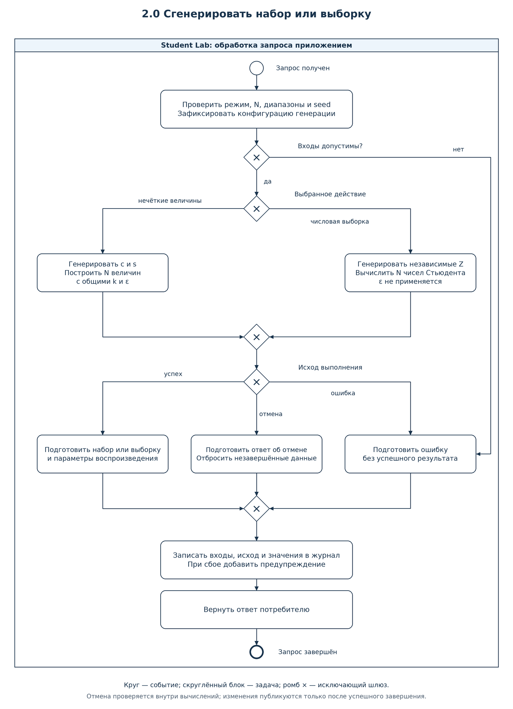
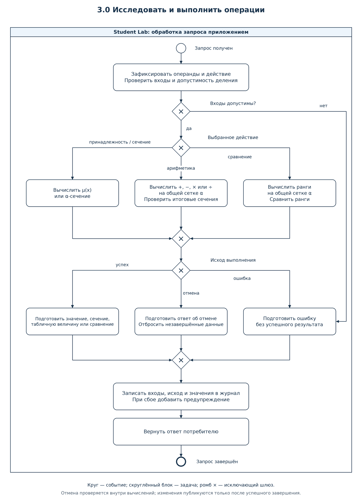
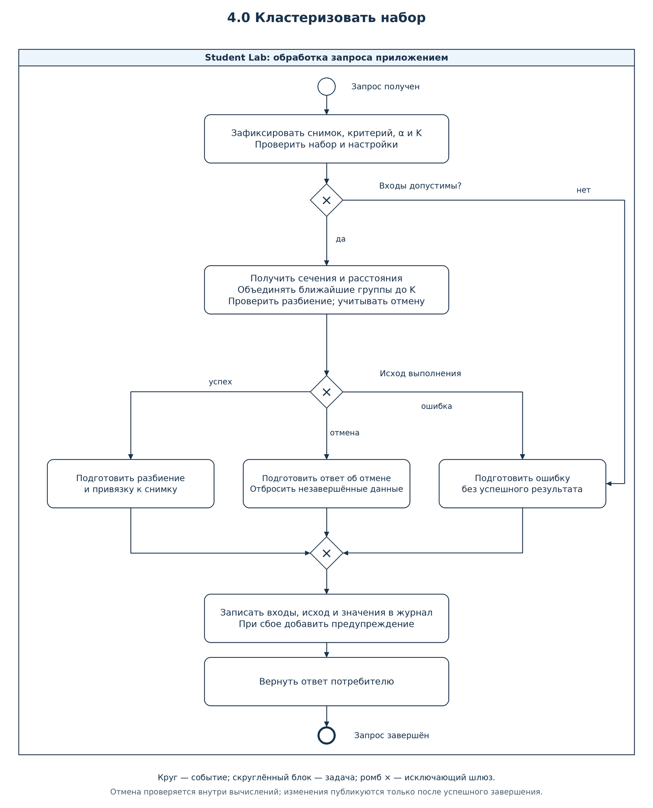
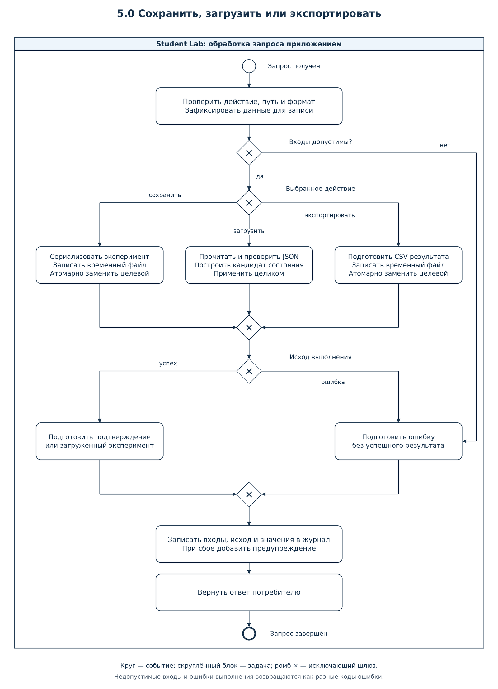
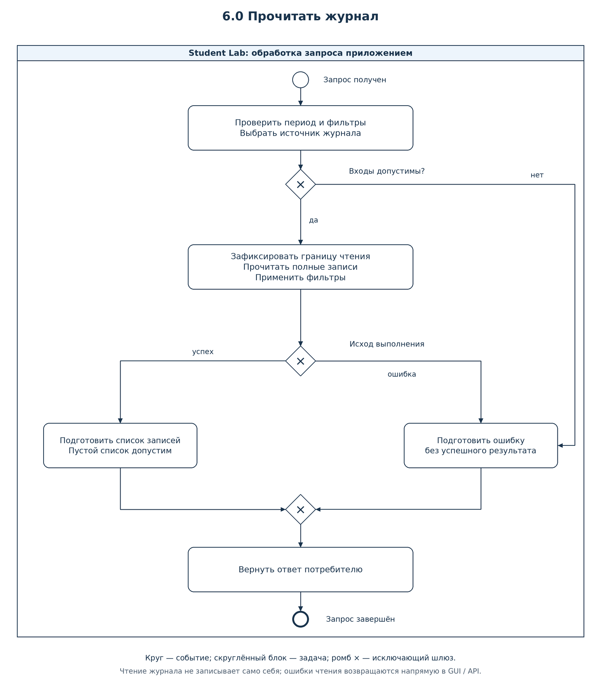

# Процессы приложения

Каждая функция раскрыта собственной BPMN-моделью. Схемы доступны в PNG, SVG и BPMN XML с графической разметкой DI.

## Общие соглашения

Граница процесса — обработка запроса вычислительной и прикладной частью приложения. GUI или Java-клиент уже передал запрос к началу процесса; окончание означает возвращенный ответ. Работа пользователя внутри GUI, транспорт сообщений и последовательность Java-методов не моделируются.

Задачи проверки возвращают признак допустимости и диагностические сведения. Рабочие задачи возвращают `SUCCESS`, `FAILED` или, где предусмотрено, `CANCELLED`. Предметные и численные ошибки обрабатываются внутри задачи и становятся обычными данными ответа; это не необработанные BPMN Error Events. Шлюзы по исходу используют эти данные. Ветви режима взаимоисключающие; неизвестный режим отклоняется при проверке входов, до шлюза выбора.

Рабочая задача 1.0–4.0 включает вычисление, проверку и последовательную публикацию результата/снимка приложением; это завершающий шаг внутри задачи. Перед публикацией проверяется отмена, если она поддерживается. Успешный исход возвращается после публикации.

Ветвь успеха собирает ответ с результатом, ветвь ошибки — код и описание причины, ветвь отмены — подтверждение отмены. Критические проверки результата выполняются внутри рабочей задачи **до** исхода успеха. Последующая задача подготовки ответа не выполняет новых вычислений или файловых действий, способных изменить исход. Ожидаемые ошибки имеют коды `INVALID_INPUT`, `DIVISOR_CONTAINS_ZERO`, `NUMERIC_FAILURE`, `IO_FAILURE`, `UNSUPPORTED_FORMAT`, `INVALID_DATA`; конкретные типы Java будут уточнены при реализации.

В 1.0–5.0 после формирования исхода предпринимается запись значений в журнал. Ошибка журнала добавляет `LOG_WRITE_FAILED`, сохраняя исход операции и результат. В 6.0 такой задачи нет: чтение журнала не журналирует само себя. Запись журнала описывает значения, а не только идентификаторы; состав — в §5 архитектуры.

Библиотека вычислений синхронная. GUI организует фоновые задачи. Отмена в 2.0–4.0 проверяется внутри циклов до публикации результата; после публикации уже наступил успех. В 1.0 и 5.0 пользовательская отмена начатой операции в первой версии не предусмотрена. Чтение журнала ограничивается зафиксированным размером файла; GUI не блокируется ожиданием.

## 1.0 — задать и изменить величины

**Вход:** действие создания или изменения, параметры c/s/k/ε, ссылка на редактируемую запись при изменении, текущая версия состояния.

**Проверки:** параметры конечны, s>0, k — положительное целое, 0<ε<1; носитель вычислим; редактируемая запись существует. Предметная запись не изменяется на месте.

**Действия:** создать объект величины, запись с новым ID и новый снимок набора. Заменить активный снимок одной последовательной операцией приложения. При ошибке до публикации прежний снимок остается активным.

**Выход в E1:** запись величины, новый снимок либо ошибка. **D1:** новый снимок при успехе. **D2:** параметры и созданное значение либо ошибка.

## 2.0 — сгенерировать набор или выборку

**Вход:** режим, N, seed, диапазоны c и s для нечётких величин; либо параметры c/s/k для обычной числовой выборки. Для нечёткого режима k и ε общие. При использовании сохранённых настроек они читаются из D1.

**Проверки:** известный режим, положительный N, допустимые параметры и диапазоны. Сценарий лабораторной генерации нечётких объектов принимает N от 100 до 300; низкоуровневый генератор библиотеки допускает другое положительное N. Параметр ε к обычной выборке Стьюдента не относится.

**Ветви:** первая создает N полных нечётких величин из случайных параметров c/s; вторая создает N скалярных реализаций распределения Стьюдента. Это разные типы результата. При отмене частичный набор отбрасывается.

**Выход в E1:** набор или числовая выборка, параметры воспроизведения, исход. **D1:** результат запуска; нечёткий набор публикуется как новый снимок только целиком. Он не перезаписывает другой активный эксперимент, открытый во время расчёта. **D2:** конфигурация, значения, исход.

## 3.0 — принадлежность, арифметика и сравнение

**Вход:** вид действия; один объект и x для принадлежности, один объект и α для сечения, два операнда и оператор для арифметики либо сравнения; общая сетка для арифметики и ранжирования. Операнды берутся из зафиксированного снимка D1.

**Проверки:** наличие нужного количества входов, допустимость x/α/сетки, согласованность представления. Только для деления проверяется, что замкнутый носитель делителя не содержит ноль. Уровень α=0 означает замыкание положительного носителя. Для просмотра сечений допускается весь [0,1].

**Ветви:** принадлежность/сечение возвращает скаляр/интервал; арифметика возвращает табличную нечёткую величину; сравнение возвращает два ранга и отношение между ними. Равные ранги не маркируются как совпадение функций. Таблица результата проверяется на конечность и вложенность до регистрации успеха.

**Выход в E1:** ответ выбранного типа или ошибка/отмена. **D1:** результат запуска с исходными операндами и конфигурацией. Само вычисление не подменяет операнды. Добавление полученной величины в рабочий набор — отдельное действие приложения, создающее новый снимок. **D2:** входные значения и вычисленный результат либо исход ошибки/отмены.

## 4.0 — кластеризовать набор

**Вход:** непустой снимок, критерий расстояния, общий уровень 0<α<1, целое 1≤K≤N. **Настройки первой реализации:** расстояние по двум границам α-сечения, агломеративное объединение и средняя связь.

Вычислительная задача раскрывается следующим алгоритмом:

1. Вычислить α-сечения и попарные расстояния; проверить конечность.
2. Создать N одиночных групп.
3. Пока групп больше K: проверить отмену, выбрать ближайшую пару, объединить её, обновить средние межгрупповые расстояния и записать шаг истории.
4. При равных расстояниях выбрать пару по стабильным идентификаторам. При K=N цикл пуст.
5. Проверить результат: ровно K непустых групп, каждая входная запись встречается ровно один раз, посторонних записей нет. Только после этого вернуть успех.

Это последовательный цикл внутри вычислительной задачи, а не параллельные BPMN-ветви. Ошибка расстояния или проверки разбиения означает `FAILED`; отмена означает `CANCELLED`, без успешного результата.

**Выход в E1:** разбиение, история N−K объединений и исход. **D1:** результат, связанный с исходным снимком. **D2:** настройки, значения входов, состав групп и исход.

## 5.0 — сохранить, загрузить или экспортировать

**Вход:** действие, путь, формат; данные эксперимента или результата из D1. **D3:** локальные файлы. Режимы разделены до работы с файлом.

- **Сохранение:** собрать JSON с версией формата; записать временный файл рядом с целевым, закрыть его и атомарно заменить целевой. При ожидаемой ошибке прежний целевой файл сохраняется; временный удаляется по возможности. Гарантия относится к целостности замены, а не к сохранности после аппаратного сбоя.
- **Загрузка:** прочитать JSON, проверить версию, инварианты, уникальность ID, все ссылки, принадлежность результатов своим снимкам и допустимость таблиц сечений. Построить кандидат эксперимента и только после полной проверки применить целиком. Неизвестная версия формата отклоняется; автоматических миграций в первой версии нет.
- **Экспорт:** получить выбранный результат, сформировать CSV с явными колонками и настройками; использовать тот же принцип временного файла и атомарной замены. CSV — результат для просмотра, не формат полного восстановления эксперимента.

Если атомарная замена не поддерживается, адаптер возвращает ошибку, сохраняя прежний файл. Запись непосредственно поверх прежнего файла не является резервным вариантом. Проверка доступа до записи не гарантирует успеха — ошибка самой операции также обрабатывается.

**Выход в E1:** подтверждение с путем или новый эксперимент либо ошибка. **D1:** меняется только при успешной загрузке. **D3:** обновляется при успешном сохранении/экспорте. **D2:** действие, исход и соответствующие значения; после загрузки запись относится к загруженному эксперименту. Расчёты старого эксперимента не подменяют загруженное состояние.

## 6.0 — прочитать журнал

**Вход:** период и фильтры; **D2:** файл журнала JSON Lines. Проверяются порядок дат и допустимость фильтров.

Приложение фиксирует размер файла на старте чтения и читает только полные записи до этой границы. Новые записи попадут в следующий запрос. Несуществующий или пустой журнал дает пустой список с пояснением. Неполная последняя строка пропускается с предупреждением. Поврежденная полная запись и отказ доступа возвращают ошибку, а не молча усеченный «успешный» журнал.

**Выход в E1:** записи, пустой список, предупреждение или ошибка. **D1 и D2 не изменяются.** Ошибки чтения показываются непосредственно в GUI/ответе API; повторная запись ошибки чтения в тот же журнал запрещена.

## Согласованность с DFD

Во всех шести моделях E1 получает ответ. Функции 1.0–5.0 читают и/или изменяют D1 согласно выбранному действию и предпринимают запись в D2. Только 5.0 обращается к D3, только 6.0 читает D2 без его изменения. Стрелки DFD не задают порядок выполнения: последовательность и ветвления представлены в BPMN.

Подробности математических задач — в [math-model.md](math-model.md); программные компоненты и зависимости — в [architecture.md](architecture.md).
